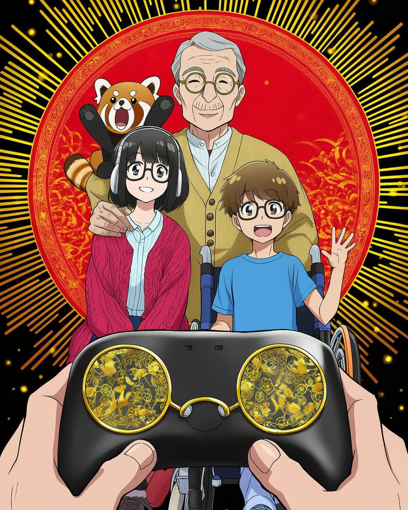

# Claude 案「4人目は、あなた。」

**見た人が、そのまま4人目のプレイヤーになる。**
あなたの手には、越前漆器の黒漆と金の蒔絵でできた、**めがねの形のコントローラー**。
その向こうで、おじいちゃん、女の子、車いすの男の子、レッサーパンダが「一緒にやろう！」と手を振っている。

| ファイル | 内容 |
|---|---|
| [concept.md](concept.md) | コンセプト、鯖江らしさの対応表、他案との違い、気になる点 |
| [prompts.md](prompts.md) | プロンプト・設定の全文、使ったツールと商用利用、試行の経緯 |
| `final/claude-4th-player-3200x4000.png` | **応募用データ**（4:5、3200×4000） |
| `final/original-novelai-s1357159947.png` | NovelAI の生成原本（896×1152、プロンプト・seed が埋め込み済み） |
| `final/preview-1200x1500.jpg` | プレビュー |
| `process/` | 試行の画像（00_一覧.jpg に全部） |
| `scripts/` | 拡大・描き直し（`upscale_claude.py`）と顔の保持（`face_keep.py`） |

- 生成：NovelAI V4.5 Curated（参照画像なし、文章のみ）
- 拡大：NovelAI 2倍 → ComfyUI（Animagine XL 4.0 ＋ ControlNet tile）で 3200×4000
- コンテスト応募・X 投稿はしていない（応募はユーザーが判断）。
