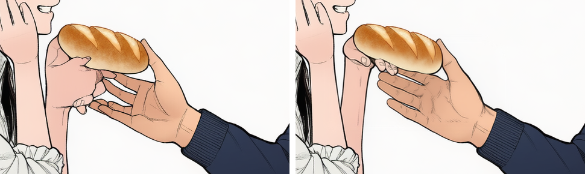
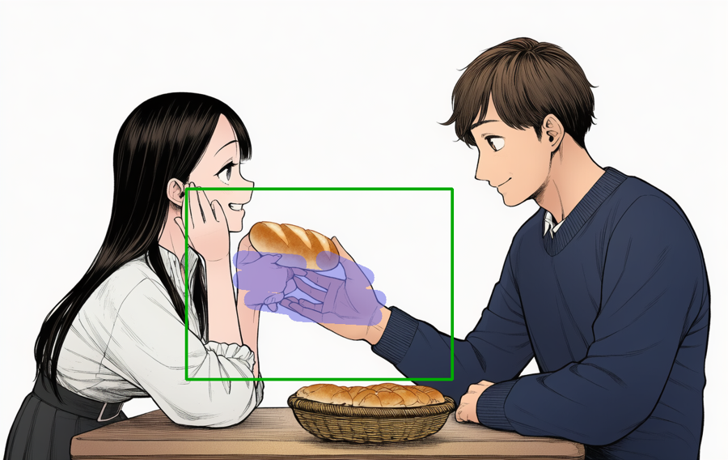
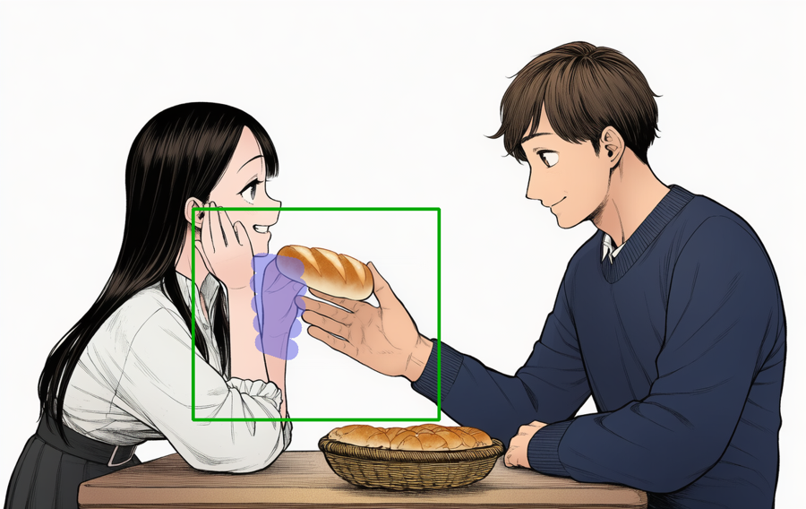

# NovelAI で手を直す（フォーカス・インペイント）— AI がブラウザ操作でやる手順

2026-10-31 Claude。NovelAI Image Generation V4.5 Curated の画面（日本語表示）で確認した。
人がマウスで塗らなくても、**ブラウザを操作できる AI（Claude in Chrome、ChatGPT のエージェントなど）だけで最後までできた**。


左：元の絵（2人の指が絡まって塊）／右：直したあと（女性が指先でパンの下を持ち、男性が上からつかむ）

---

## 0. 先に知っておくこと（ここで失敗した）

| 失敗 | 原因 | 対策 |
|---|---|---|
| 塗ったのに画像がまったく変わらない（差 0%） | 「マスク追加」を押さずに塗った／同じ seed で生成した | **編集画面に入ったらまず「マスク追加」を押す**。seed はランダム（空欄）にする |
| 生成ボタンが押せない・何も起きない | 同じ seed・同じ設定だと NovelAI は生成しない | seed を変える |
| 2人の手を一度に塗ったら、片方の手が消えた | 1回の生成で2人分の手を描かせると、片方が腕に溶ける | **1人ずつ直す**。良くなった方の画像を次の土台にする |
| 画像を入れたら「NovelAIポーション」に入り、生成が有料（2 アンラス）になった | ページにはファイル入力が複数ある。別の入力に入れた | 下の §2 の方法で i2i の入力を選ぶ。入ってしまったら、ごみ箱で消す |
| プロンプトが日本語に変わって見える | Chrome の自動翻訳 | 表示だけのことが多いが、保存した PNG の Comment でプロンプトが英語のままか確かめる |

**費用：** 1216×768 程度の画像なら、インペイントは **0 アンラス**（Opus プラン）。精密参照を付けていると 5 アンラスになるので外しておく。

---

## 1. 準備
- 直したい画像（NovelAI で作った PNG。プロンプトが埋め込まれているもの）
- 確かめ用のスクリプト（§6）。Python と Pillow、numpy

## 2. 画像を i2i に入れる
1. `https://novelai.net/image` を開く。
2. 左の「参照画像」の欄にある **i2i（元画像を加工し新しい画像を生成する）** に画像を入れる。
   - ブラウザ操作の道具でファイルを入れるとき：`input[type=file]` は8個ある。**ページ内の最初の file input が i2i**。見分けにくければ、JavaScript で最初の入力に目印（aria-label など）を付けてから、その入力にアップロードする。
3. 「この画像で何がしたいのですか？」が出る。
   - 1回目：プロンプト・言いたい要素・キャラクター・設定にチェックを入れて **「メタデータをインポート」**（元の文と設定を戻す）。
   - 2回目：同じ画像をもう一度入れて **「画像2画像」**。
4. 左の i2i の欄に小さな画像と「インペイント」ボタンが出れば成功。

## 3. 直す人の文に「手の言葉」を足す
キャラクタープロンプトのうち、**直す人の欄の最後**に足す。例（パンを渡す女性）：
```
, 2::her hand holding the bread from below, five fingers::, detailed hands
```
`2::…::` は強調。手の向き（下から持つ、上からつかむ）まで書くと読める手になりやすい。

## 4. マスクとフォーカスの四角を描く
1. i2i の欄の **「インペイント」** を押す → 編集画面が開く。
2. **左上の「マスク追加」を押す**（これを忘れると塗りが保存されない）。
3. ペンサイズを **12 前後**にする（左上のつまみ。38 は大きすぎて顔まで塗れた）。
4. 直す手の上を **ドラッグで塗る**（クリックで点を打つのではなく、線を引く）。1本 40〜100px くらいの横線を、手の形に沿って数本。画面に紫の塗りが見えれば入っている。
5. 下の道具の4つ目 **「フォーカスエリア選択」** を選び、手のまわりを四角でドラッグ（顔は入っても、塗っていなければ変わらない）。
6. 右上の **「保存して閉じる」** を押す。左の欄の見出しが「ベースプロンプト」になればインペイントの状態。

1回目（2人分を塗った例）と2回目（女性の手だけ）：



紫：塗った所（マスク）／緑：フォーカスの四角

## 5. 生成して選ぶ
1. seed は空欄（ランダム）のまま「1枚のみ生成」（0 アンラス）。
2. **同じマスクのまま 2〜4 枚**出す。手の出来は seed で大きく変わる（今回は4枚中1枚が使えた）。
3. 気に入った枚を保存（画像の下のダウンロード）。
4. もう1人の手も直すなら、**保存した画像を土台にして §2 からやり直す**。

## 6. 確かめる（目で見るだけで合格にしない）
元と結果の差を数える。**四角の外が 0% なら、マスクとフォーカスが効いている**。
```python
import numpy as np
from PIL import Image
a = np.asarray(Image.open('元.png').convert('RGB')).astype(int)
b = np.asarray(Image.open('結果.png').convert('RGB')).astype(int)
ch = np.abs(a - b).max(2) > 12          # 変わった画素
print('変わった画素 %.2f%%' % (ch.mean() * 100))
x0, y0, x1, y1 = 290, 315, 662, 633     # フォーカスの四角（画像の座標）
out = np.ones_like(ch); out[y0:y1, x0:x1] = False
print('四角の外 %.3f%%' % ((ch & out).sum() / out.sum() * 100))
```
- 変わった画素が **0%** → マスクが入っていない（「マスク追加」を押したか、seed を変えたか）。
- 四角の外が 0% でない → 普通の i2i になっている（インペイントの状態になっていない）。
- 保存した PNG の Comment／Source に `NativeInfillingRequest` があればインペイントの記録。
- 最後に、手のまわりを **2〜3 倍に拡大して** 指の数と形を見る。縮小画像だけで合格にしない。

## 7. 今回の数字
| 回 | 塗った所 | seed | 変わった画素 | 四角の外 | 手 |
|---|---|---|---|---|---|
| 1 | 2人の手 | 1925053869 | 1.80% | 0.000% | 男性○／女性の手が消えた |
| 1 | 2人の手 | 2032146619 | 1.66% | 0.000% | 男性○（次の土台）／女性× |
| 2 | 女性の手だけ | 4103629836 | 0.54% | 0.000% | 塊 |
| 2 | 女性の手だけ | 3078735315 | 0.76% | 0.000% | 男性の指と重なる |
| 2 | 女性の手だけ | 28620712 | 0.44% | 0.000% | 指が少ない |
| 2 | 女性の手だけ | **2627748284** | 0.50% | 0.000% | **採用** |

すべて 0 アンラス。

## 8. うまくいかないとき
- 指が塊になる → 塗る範囲を少し広げて手首まで入れる。文に `five fingers` と手の向きを足す。seed を変えて枚数を出す。
- 手が腕に溶ける → 2人分を一度に塗っていないか。1人ずつにする。
- 周りまで変わる → ペンが太すぎる。四角を小さく。
- 画面が固まってスクリーンショットが取れない → ページを読み直す（「ページを離れますか」が出たら閉じる）。生成した画像は右の「履歴」に残る。
